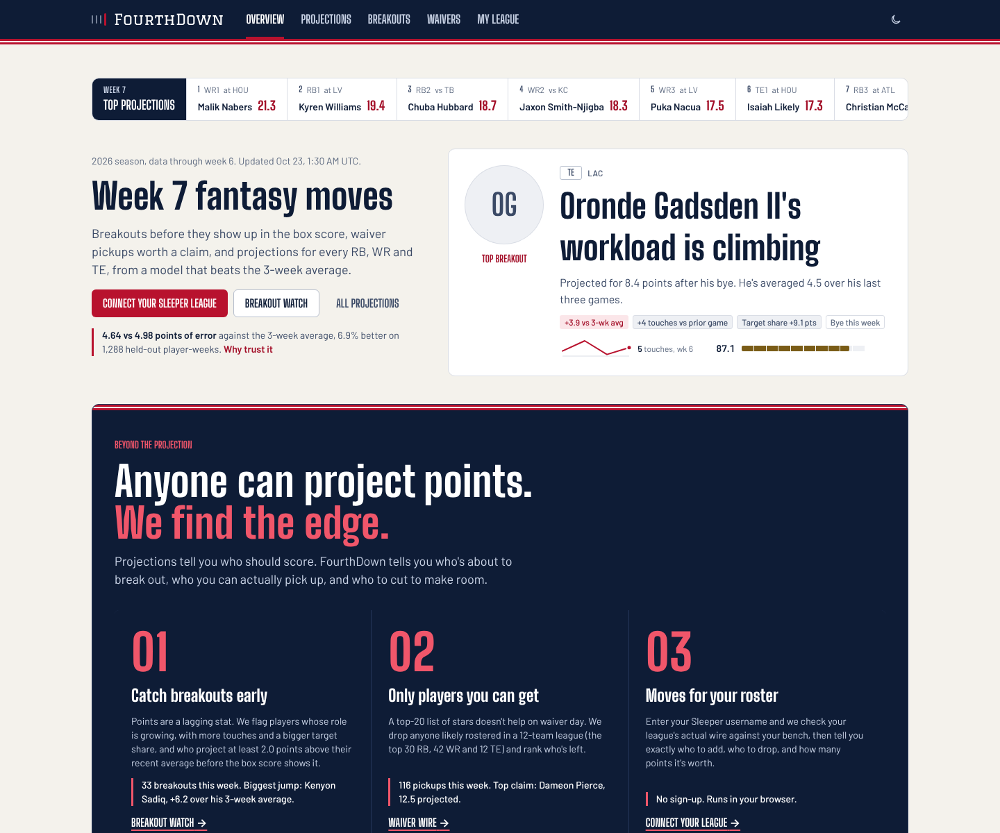
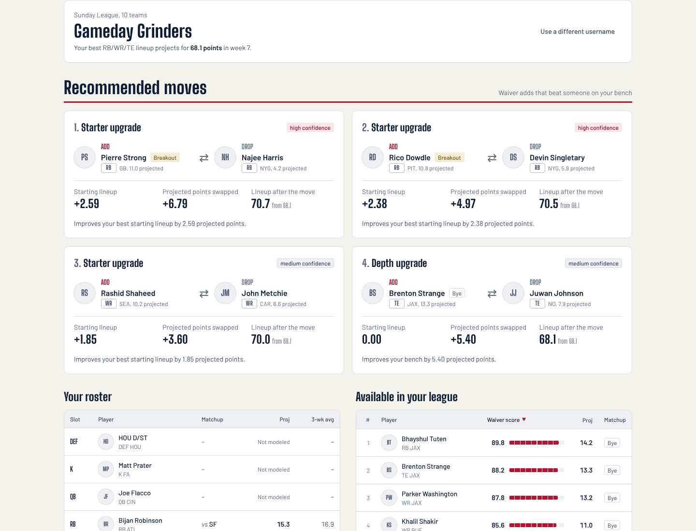
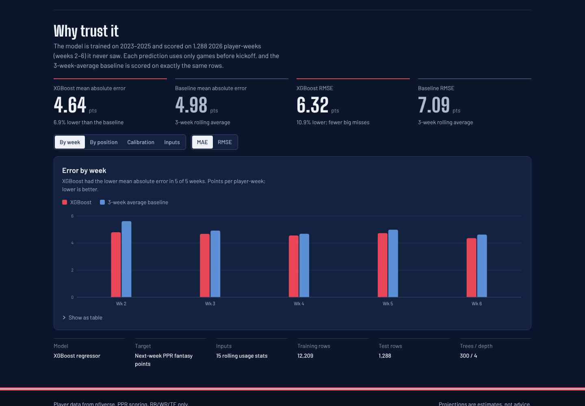
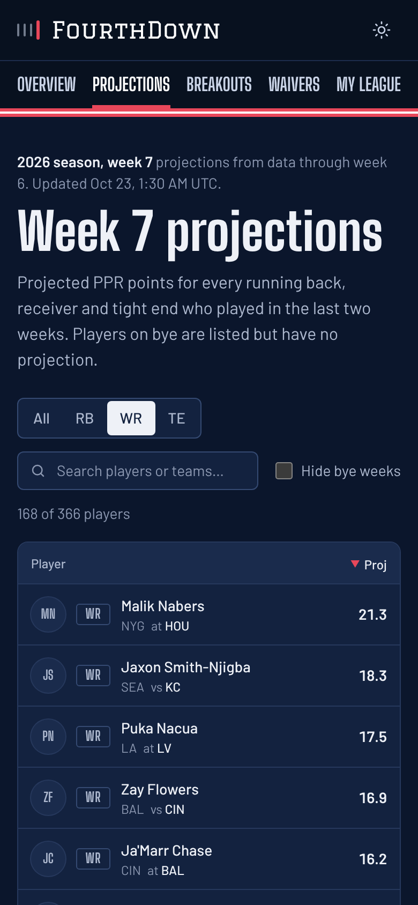
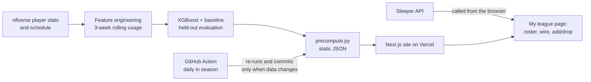

# FourthDown

[](https://github.com/sahgat11/FourthDownAI/actions/workflows/ci.yml)
[](https://github.com/sahgat11/FourthDownAI/actions/workflows/refresh-data.yml)

**Live site: [fourth-down-ai.vercel.app](https://fourth-down-ai.vercel.app)**

Anyone can project fantasy points. FourthDown is built for the decisions that actually win leagues:

- **Breakouts before the box score.** Players whose role is growing (more touches, a bigger target share) and who project well above their recent average, flagged before the points show up.
- **Waiver pickups you can actually get.** Players likely rostered in a 12-team league are filtered out, so every name is a real claim.
- **Add/drop moves for your roster.** Enter a Sleeper username and the site checks your league's real waiver wire against your bench, then ranks the moves by how much they improve your starting lineup.

Under all three is an XGBoost model that projects next-week PPR points for every active RB, WR and TE, and grades itself against the obvious alternative: assuming each player repeats his 3-week average.



## Results

Held-out evaluation on the 2026 season (weeks 2–6, snapshot from October 21, 2026). The model is trained on 2023–2025 and never sees the games it is scored on; both models are scored on exactly the same 1,288 player-weeks.

| | Mean absolute error | RMSE |
|---|---:|---:|
| 3-week average baseline | 4.98 | 7.09 |
| **XGBoost** | **4.64** | **6.32** |
| Improvement | 6.9% | 10.9% |

XGBoost had the lower error in every test week and at every position. The live site always shows the current numbers, read from the same precomputed files the model writes; nothing on the site is hard-coded.

## What's on the site

| Page | What it shows |
|---|---|
| **Overview** | A sports-feed front page: this week's breakout stories with usage trends, the top waiver targets, and a "why trust it" section with model vs baseline by week and position, a calibration check and the inputs the model relies on |
| **My league** | Connect a Sleeper league with just a username: your roster, the players actually available in your league, and ranked add/drop moves with the starting-lineup gain for each. Runs entirely in the browser; links are shareable (`/league?user=...&league=...`) |
| **Breakouts** | Players projected to beat their 3-week average by 2+ points, scored by projected gain and growth in touches and target share |
| **Waivers** | Likely-available players ranked by waiver score (estimated availability; connect a league for the exact wire) |
| **Projections** | Every active RB/WR/TE with projection, matchup, position rank and usage, filterable and shareable by URL (`/projections?pos=te`) |



<p>
  
  
</p>

## How it works



- **Model.** 15 features per player-game: 3-week rolling averages of PPR points, targets, carries, receptions, yards, touchdowns, air yards, target share, air-yards share and WOPR, plus week-over-week changes in target share and opportunities. Row *N* predicts week *N+1*.
- **No leakage.** Train/test split by season; a completeness check detects partially reported weeks so they never enter training or scoring.
- **Static by design.** The XGBoost pipeline is too heavy for serverless functions, so `backend/precompute.py` runs it ahead of time and writes six JSON files (`frontend/public/data/`). The site is fully static and loads data in the browser with loading, empty and error states. The schema is documented in [`backend/DATA_SCHEMA.md`](backend/DATA_SCHEMA.md).
- **Fresh data.** [`refresh-data.yml`](.github/workflows/refresh-data.yml) runs every morning during the season: tests, retrain, a guard that refuses to publish if XGBoost stops beating the baseline, then a commit only if the data changed. Vercel redeploys on push.
- **League moves in the browser.** The My league page calls Sleeper's public API directly and runs a TypeScript port of the Python move engine: it finds your league's real waiver wire, builds your best starting lineup (players on bye can't start and are never dropped), and scores each add/drop by starting-lineup gain, projected points swapped, depth risk and breakout signal. A parity test checks the TypeScript output against the Python engine on a fixture league, to 9 decimal places. The same engine is also available locally through a CLI and a FastAPI server.

## Quality

- **162 Playwright end-to-end tests** across desktop and phone: navigation, theming, every chart's table view, sorting, filtering, search, URL state, loading/empty/error states (including offline and malformed data), the league flow against a mocked Sleeper API (unknown user, no leagues, offline, shared links), and **axe WCAG 2.2 AA scans** of every page in light and dark mode. The tests read the same data files as the site, so a displayed number that disagrees with the model output fails the build.
- **Backend tests** run the full pipeline on synthetic data (no network) and check the published metrics against the model code.
- **CI** runs both suites, lint and the production build on every push and pull request. Dependabot keeps dependencies current.

## Run it locally

Requires Python 3.12+ and Node 20+.

```bash
# Backend: model + data
python -m venv venv && source venv/bin/activate
pip install -r backend/requirements-dev.txt
python backend/precompute.py            # downloads nflverse data, writes frontend/public/data
python -m pytest backend/tests          # backend tests

# Frontend
cd frontend
npm ci
npm run dev                             # http://localhost:3000

# End-to-end tests (first time: npx playwright install chromium)
npm run test:e2e:build
```

Optional local league mode (the site's My league page does the same in the browser):

```bash
python backend/main.py --league-id <SLEEPER_LEAGUE_ID> --username <SLEEPER_USERNAME>
cd backend && uvicorn api:app --reload   # FastAPI at http://localhost:8000/docs
```

## Project structure

```
backend/
  pipeline.py           shared pipeline used by the CLI, API and precompute
  feature_engineering.py, ml_model.py, baseline_model.py
  breakout_engine.py, waiver_engine.py, team_engine.py, move_engine.py
  precompute.py         writes the site's JSON;  check_metrics.py  publish guard
  api.py, main.py       optional local league mode (FastAPI / CLI)
  tests/
frontend/
  src/app/              Overview, My league, Breakouts, Waivers, Projections (+ /design system page)
  src/components/       design system, feed stories, charts, tables, league views
  src/lib/league/       Sleeper client and the in-browser move engine
  e2e/                  Playwright tests
  public/data/          model output (refreshed by GitHub Actions)
.github/workflows/      ci.yml, refresh-data.yml
```

## Stack

Python, pandas, XGBoost, scikit-learn, nflreadpy, FastAPI · Next.js, React, TypeScript, Tailwind CSS · Playwright, axe-core, pytest · GitHub Actions, Vercel

## Notes and limits

- PPR scoring, RB/WR/TE only. Projections are estimates, not advice.
- Waiver availability on the public pages is estimated (top 30 RB / 42 WR / 12 TE by season points are treated as rostered). Connect a league on the My league page for exact availability.
- League moves cover RB/WR/TE; QB, K and DEF appear on your roster but aren't projected.
- Player data from [nflverse](https://github.com/nflverse). Not affiliated with the NFL or Sleeper.
